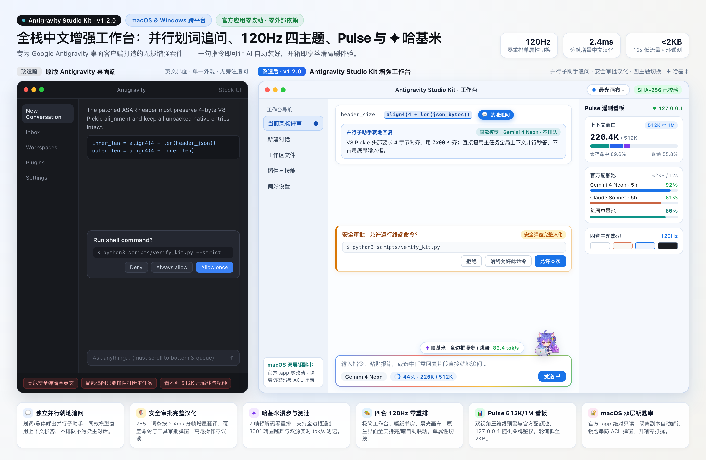
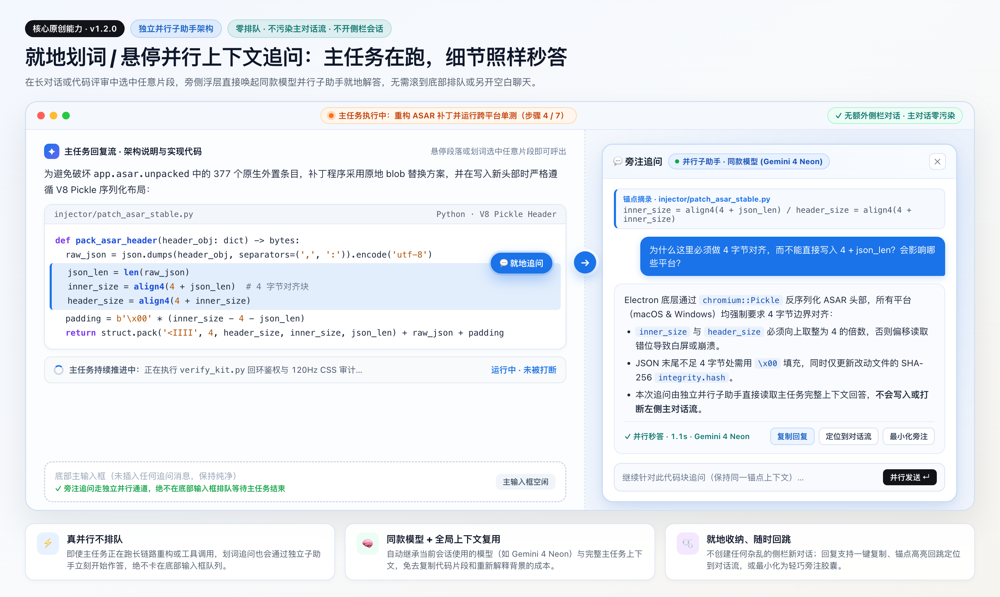
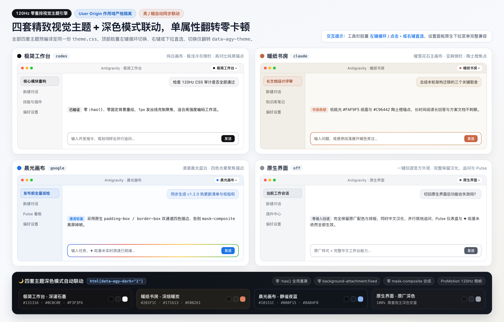
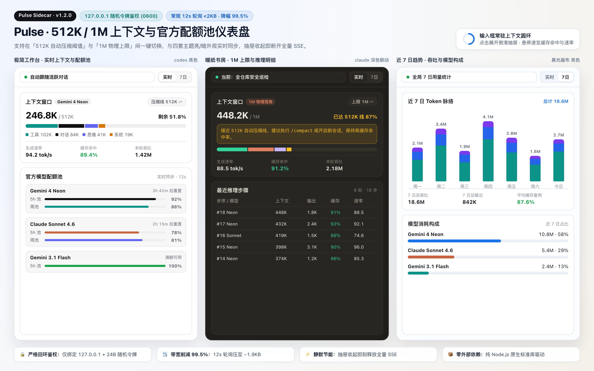
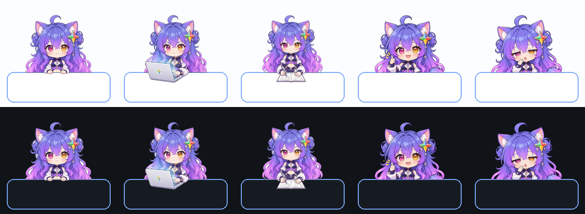

# Antigravity Studio Kit（Antigravity 增强工作台套件）

[](LICENSE)
[](https://github.com/cool-boy2024/antigravity-studio-kit/releases)
[](#手动命令行快速部署)
[](#仓库布局)
[](AI_INSTALL.md)

面向 **Google Antigravity** 桌面客户端的跨平台增强工作台套件（支持 **macOS & Windows**，零外部运行依赖）。在坚持官方安装体零破坏与严格本地安全边界的前提下，为桌面端补齐 **独立并行子助手就地划词追问**、**2.4ms 帧预算全量中文汉化（含安全审批弹窗）**、**四套 120Hz 零重排视觉主题（亮/暗联动 & 设置下拉菜单完整兼容）**、**Pulse 512K / 1M 上下文与配额池看板**、**全边框漫步 / 转圈跳舞 + 双源实时测速的 ✦ 哈基米** 以及 **macOS 零污染隔离预览与双层钥匙串防弹窗架构**。



---

## 🤖 懒人首选：直接发给你的 AI，一句指令自动装好（无需自己敲命令）

本仓库内置确定性 Agent 部署手册（[`AI_INSTALL.md`](AI_INSTALL.md) + [`AGENTS.md`](AGENTS.md) + [`CLAUDE.md`](CLAUDE.md)）。**把下面这句话直接复制发给你的 Antigravity AI、Claude Code 或 Codex**，它会自动完成系统识别、环境预检、`verify_kit.py` 安全自检与无损部署：

```text
请帮我安装并验证 https://github.com/cool-boy2024/antigravity-studio-kit ：先克隆（或更新）仓库并阅读其中的 AI_INSTALL.md，严格按我的操作系统完成环境预检、scripts/verify_kit.py 安全自检和 install.py 部署，全程严禁修改 macOS 官方 /Applications/Antigravity.app 或触碰系统真实钥匙串，完成后告诉我如何打开与验证。
```

> 💡 **升级 / 卸载也只需一句话**：告诉 AI「按 `AI_INSTALL.md` 帮我更新（或无损卸载）`antigravity-studio-kit`」即可。如需手工命令行部署，请直接跳至 [手动命令行快速部署](#手动命令行快速部署)。

---

## 核心能力详解

### 1. 独立并行子助手就地划词 / 悬停追问（核心原创能力）

长对话与复杂代码评审中，最打断思路的痛点是「对中间某段代码或结论有疑问，却只能滚到底部等主任务跑完排队提问，或者另开空白对话重新喂上下文」。



- **真并行不排队**：在回答段落或代码块上**悬停**或**划词选中**即可呼出 `💬 就地追问` 旁侧浮层，后台唤起独立并行子助手立即作答——哪怕主任务正在执行多步重构或工具调用，也**绝不卡在底部输入框队列**。
- **同款模型 + 全局上下文复用**：自动继承当前会话所使用的模型（如 `Gemini 4 Neon`）与主任务完整上下文，无需复制粘贴背景说明。
- **零污染主对话流与侧栏**：不新建杂乱的可见侧栏聊天，也不把零碎提问塞进主对话流；浮层内置 **复制回复 / 定位到对话流 / 最小化旁注** 快捷操作，读完即收。

---

### 2. 四套 120Hz 零重排视觉主题（亮 / 暗自动联动 + 设置下拉菜单完整兼容）



- **四套精致外观一键热切**：顶部工具栏胶囊 **左键循环切换 / 点击 `▾` 或右键直选**：
  - **极简工作台（`codex`）**：纯白画布 + 极浅冷灰侧栏 + 1px 发丝线 + 高对比纯黑锚点；深色自动切换为**深邃石墨**。
  - **暖纸书房（`claude`）**：暖雪花石纸面（`#FAF9F5`）+ 亚麻侧栏 + 陶土橙焦点，适合长文阅读；深色自动切换为**深焙暖炭**。
  - **晨光画布（`google`）**：清澈蓝白画布 + 原生双通道四色光晕输入描边；深色自动切换为**静谧夜蓝**。
  - **原生界面（`off`）**：一键回退官方原厂视觉，同时完整保留中文汉化、并行就地追问、Pulse 看板与 ✦ 哈基米。
- **120Hz ProMotion 丝滑架构**：全部规则预编译至 User Origin 样式表并通过 `html[data-agy-theme]` 与 `html[data-agy-dark="1"]` 严格隔离，切换仅为单属性翻转（零 CSS 重解析）；彻底清除 `:has(`、`background-attachment: fixed` 与 `mask-composite` 掉帧瓶颈，同时对**设置面板与 Radix 下拉菜单**做实底防穿帮与层级兼容，辅助栏标签关闭按钮稳定可点。

---

### 3. 2.4ms 帧预算全量增量中文汉化（完整覆盖安全审批弹窗）

- **安全审批弹窗完整汉化**：词典（`theme/localization_dict.json`，755+ 词条）除覆盖主工作区、导航侧栏与深层设置面板外，重点完整覆盖终端命令执行、文件修改与工具调用的**安全审批弹窗**，降低高危授权确认时的误读风险。
- **2.4ms 分帧零卡顿引擎**：全部词条预编译为单条 V8 正则配合 1500 条结果缓存，脏节点在 `requestAnimationFrame` 内按 **2.4ms 帧预算** 增量提交，并 O(1) 跳过回答正文、代码块（`pre`/`code`）、编辑器与输入框，既不误译技术内容，也不影响 120Hz 流畅度。

---

### 4. Pulse · 512K / 1M 上下文与官方配额池仪表盘



- **512K 自动压缩线 ⇄ 1M 物理上限双视角**：输入框旁常驻上下文圆环与侧滑抽屉，默认以 Agent 实战触发压缩的 **512K 自动压缩线** 计算剩余续航与缓存命中率，支持一键切换至 **1M 模型物理上限** 视角并查看分段占比与推理明细。
- **官方配额池与近 7 日趋势**：同步呈现各模型 5 小时池 / 每周配额余量、重置倒计时与近 7 日 Token 消耗构成，外观与当前主题亮/暗状态实时联动。
- **低流量 + 严格回环鉴权**：常规 12s 轮询压至 `<2KB`（较全量查询削减 99.5% 带宽），静态元数据按 1 小时缓存，抽屉收起即断开全量 SSE；Sidecar 仅监听 `127.0.0.1` 动态端口，每次启动生成 24 字节随机令牌写入 `0600` 权限 `runtime.json`，强制校验回环 `Host` / `Origin`。

---

### 5. ✦ 哈基米：全边框漫步 / 360° 转圈跳舞 + 双源实时测速



- **零重排 7 帧预解码精灵**：启动阶段一次性将 7 帧透明 PNG 预解码为堆叠图层，切换思考、敲代码、记笔记、完成、小憩等姿态仅修改 `opacity`，定位由 `ResizeObserver` + `transform: translate3d` 驱动。
- **鲜活微交互 + 双源实时测速**：支持沿输入框**全边框漫步**、任务完成后开心 **360° 转圈跳舞**；同时融合流式输出与 Pulse 遥测提供**双源实时 `tok/s` 测速**胶囊，右键可随时收起为极简状态标签或重新唤出。

---

### 6. macOS 零污染隔离预览（双层钥匙串防弹窗）& 静默 SHA-256 热更新

- **官方应用 100% 只读**：macOS 绝不原地改动 Google 签名的 `/Applications/Antigravity.app`；安装器自动构建并本机 ad-hoc 签名独立副本 `~/Applications/Antigravity Community Preview.app`，所有数据与插件隔离存放于独立目录。
- **双层钥匙串防弹窗守护**：结合 Electron 层 `--use-mock-keychain` 与独立 `language_server` 隔离目录自动解锁登录钥匙串（含升级 `CDHash` 变更防 ACL 弹窗机制），彻底避免独立环境反复弹出「找不到钥匙串 / 还原为默认」或反复输入系统密码。
- **静默 SHA-256 热更新**：后台按 30 分钟间隔通过 `ETag 304`（不消耗 GitHub API 额度）检测 [`cool-boy2024/antigravity-studio-kit`](https://github.com/cool-boy2024/antigravity-studio-kit/releases) 新版 Release；发现更新时在设置入口旁轻提示，一键点击后对 `kit-hot-update.json` 清单中的全部文件做 SHA-256 校验并原子替换热重载。

---

## 手动命令行快速部署

运行环境要求：Python 3.9+（仅用标准库，零第三方依赖）、Node.js 22+（可选，用于 `verify_kit.py` 运行时安全测试；客户端运行时直接使用宿主 Node）。

### macOS（零污染隔离预览）
> 需已安装官方 `/Applications/Antigravity.app`（支持 `--install-dir` 指定自定义源路径）。

```bash
# 0. 可选：先运行全套语法、120Hz CSS 审计、回环鉴权与隐私自检
python3 scripts/verify_kit.py

# 1. 首次部署：构建并本机 ad-hoc 签名 ~/Applications/Antigravity Community Preview.app
python3 install.py

# 仅热更新主题、并行追问、汉化词典与插件（预览版运行中按 Cmd + R 立即生效）
python3 install.py --skip-asar

# 预览版运行中后台预构建并签名新版本，退出后原子切换并重启
python3 install.py --stage
python3 mac-preview/swap_and_launch.py

# 无损卸载预览副本（官方 /Applications/Antigravity.app 始终完好）
python3 uninstall.py
```

- **首次打开说明**：隔离预览副本使用本机 ad-hoc 签名（绝不关闭系统 SIP 或 Gatekeeper）。首次双击如提示无法验证开发者，在访达中**右键 → 打开**，或在「系统设置 → 隐私与安全性」点击「仍要打开」即可。
- 更多 macOS 隔离与双层钥匙串实现细节见 [mac-preview/README.md](mac-preview/README.md)。

### Windows（原地无损补丁与官方基线守护）
1. 先完全退出正在运行的 Antigravity（释放 `app.asar` 文件锁）。
2. 在仓库根目录执行：

```powershell
# 可选：全套本地自检与部署预演
python scripts/verify_kit.py
python install.py --dry-run

# 一键部署主题、插件并自动归档官方基线后无损补丁 app.asar
python install.py
```

- 自定义安装目录可传入 `--install-dir "D:\path\to\antigravity"`。
- 后续仅更新主题、追问浮层、词典或插件时，运行 `python install.py --skip-asar` 后在窗口内按 `Ctrl + R` 即刻热生效。
- 推荐将桌面快捷方式指向 `pythonw.exe "%USERPROFILE%\.gemini\antigravity\custom_theme\injector\launch_antigravity.pyw"`，官方升级覆盖后下次启动自动重注。
- 字节级还原官方原包与完整卸载：`python uninstall.py`。

---

## 改动边界与无损还原清单

为方便安全审计与二次开发，下表列出本套件触及的全部路径、机制与还原方式：

| 模块 | 部署位置 / 触及点 | 机制说明 | 还原方式 |
| --- | --- | --- | --- |
| **主进程挂载钩子** | `app.asar` 内 `dist/utils.js`（插入 5 行）与 `dist/custom-theme-main.js` | 在 `createWindow()` 调用 `loadURL()` 前注册 `dom-ready`；原地精准替换目标 blob，完整保留全部 `app.asar.unpacked` 外置条目并按 V8 Pickle 4 字节对齐重算头部与 SHA-256 | Windows：`python uninstall.py` 字节级恢复官方归档基线；macOS：官方 `.app` 从未被改动 |
| **视觉主题、并行追问与增量汉化** | `~/.gemini/antigravity/custom_theme/app/`（macOS 位于隔离预览主目录） | 预编译 `theme.css`、`renderer.js`、词典 `localization_dict.json` 与版本清单 `kit-meta.json`，支持 `Cmd+R` / `Ctrl+R` 即时热重载 | 切换至「原生界面」或运行卸载脚本清理 |
| **Pulse 遥测插件** | `~/.gemini/config/plugins/gemini-pulse/` | 零依赖 Node.js Sidecar，仅绑 `127.0.0.1` + 24B 随机令牌鉴权，常规 12s 轮询 `<2KB`，512K / 1M 双视角与官方配额池 | 运行 `uninstall.py` 或移除插件目录并清理 `config.json` |
| **Theme Canvas 维护技能** | `~/.gemini/config/plugins/theme-canvas/` | 提供工作台主题切换、巡检与升级维护技能指令集 | 运行 `uninstall.py` 或移除插件目录 |

完整工程实现与避坑记录请阅读 [docs/ARCHITECTURE_AND_PITFALLS.md](docs/ARCHITECTURE_AND_PITFALLS.md)，各版本变更记录见 [CHANGELOG.md](CHANGELOG.md)。

---

## 生态互补

- **[`cool-boy2024/antigravity-companion`](https://github.com/cool-boy2024/antigravity-companion)**：与本套件互补的 Antigravity 生态伴侣项目。**Antigravity Studio Kit** 专注桌面客户端本地工作台体验增强（并行划词追问、全量汉化、120Hz 四主题、Pulse 看板、✦ 哈基米与 macOS 零污染隔离），搭配 `antigravity-companion` 可进一步延展多端协同与扩展工作流，两者职责解耦、可按需独立或组合使用。

---

## 仓库布局

```text
antigravity-studio-kit/
├── README.md                            # 项目主页、AI 一句话部署入口与视觉预览
├── AI_INSTALL.md                        # 面向 AI Agent 的确定性零门槛部署与回滚手册
├── AGENTS.md                            # 通用编程 Agent 仓库指引与工程约束
├── CLAUDE.md                            # Claude Code 仓库入口说明
├── CHANGELOG.md                         # 版本发布记录（v1.2.0）
├── LICENSE                              # MIT 开源许可证与上游致谢
├── install.py                           # macOS / Windows 统一安装与智能热更新入口
├── uninstall.py                         # macOS / Windows 无损卸载与官方基线恢复
├── docs/
│   ├── ARCHITECTURE_AND_PITFALLS.md     # 架构设计与工程实践手册
│   └── assets/                          # 2x Retina 视觉展示与 ✦ 哈基米姿态图集
├── injector/
│   ├── custom-theme-main.js             # Electron 主进程 dom-ready 注入与 SHA-256 热更新器
│   ├── patch_asar_stable.py             # 无损 app.asar 精准补丁与官方基线守护
│   └── launch_antigravity.pyw           # Windows 升级自愈零常驻启动器
├── mac-preview/
│   ├── README.md                        # macOS 隔离副本与双层钥匙串防弹窗架构说明
│   ├── build_preview.py                 # 独立隔离 .app 构建脚本
│   ├── sign_preview.py                  # 本机 ad-hoc 签名脚本
│   └── swap_and_launch.py               # .app.staged 原子替换启动脚本
├── theme/
│   ├── codex.css                        # 极简工作台主题源码（亮/暗）
│   ├── claude.css                       # 暖纸书房主题源码（亮/暗）
│   ├── google.css                       # 晨光画布主题源码（亮/暗）
│   ├── renderer.template.js             # 前端核心（并行就地追问、四主题引擎、增量汉化、✦ 哈基米与 Pulse 视图）
│   ├── localization_dict.json           # 755+ 简体中文界面与安全审批弹窗词典
│   ├── kit-meta.json                    # 版本号与 GitHub Releases 更新通道元数据
│   ├── build_pack.py                    # 零依赖构建脚本（打包产出至 theme/dist/）
│   ├── dist/                            # 预编译产物（开箱即用，免装额外图像库）
│   └── art/muse-poses/                  # ✦ 哈基米 7 帧透明 PNG 素材
├── plugins/
│   ├── gemini-pulse/                    # 512K/1M 上下文与官方配额池 Sidecar 插件
│   └── theme-canvas/                    # 主题切换与升级维护 Skill 插件
├── scripts/
│   ├── verify_kit.py                    # 跨平台自动化验证、回环鉴权测试与隐私扫描
│   └── build_release_assets.py          # GitHub Release 热更新清单、全量 ZIP 与 SHA256SUMS 生成器
└── .github/workflows/
    ├── verify.yml                       # 三平台（Ubuntu / macOS / Windows）持续验证
    └── release.yml                      # 打标自动生成并发布全套 SHA-256 校验 Release 产物
```

---

## 二次定制指南

### 1. 增补或微调中文词典
编辑 [theme/localization_dict.json](theme/localization_dict.json)（格式为 `["English Phrase", "中文译文"]`），执行 `python3 install.py --skip-asar` 同步后，在客户端按 `Cmd + R`（macOS）或 `Ctrl + R`（Windows）即可即时生效。

### 2. 自定义 ✦ 哈基米角色素材
替换 `theme/art/muse-poses/` 下的 7 张透明 PNG（`muse-idle.png`、`muse-write1/2.png`、`muse-laptop1/2.png`、`muse-done.png`、`muse-sleepy.png`），重新编译并热更新：

```bash
python3 theme/build_pack.py
python3 install.py --skip-asar
```

### 3. 自建热更新通道（Fork 用户）
修改 [theme/kit-meta.json](theme/kit-meta.json) 中的 `repo` 为你自己的 `owner/repo`；推送 `v*.*.*` 标签后，[.github/workflows/release.yml](.github/workflows/release.yml) 会自动完成自检并发布带 SHA-256 校验的 `kit-hot-update.json`、热更新单文件、全量源码 ZIP 与 `SHA256SUMS`。

---

## 安全原则与 MIT 开源致谢

- **安全边界**：本套件仅用于桌面端工作流与界面体验增强，**绝不修改、绕过或弱化任何官方鉴权、账号策略、配额限制或安全审批校验**。全部本地服务仅绑定 `127.0.0.1` 并强制随机令牌与来源白名单校验，零遥测数据外发；若官方客户端升级导致挂载锚点变更，补丁程序会自动安全中止并完整保留官方 `app.asar`。
- **MIT 开源许可与致谢**：本项目基于 **MIT 协议** 开源，基础结构致谢上游社区贡献者（`Antigravity Community Contributors`），并在此之上完成了大量独立架构重构与原创功能演进（并行子助手就地追问、120Hz 四主题引擎、安全审批完整汉化、双源实时测速 ✦ 哈基米、Pulse 回环鉴权加固、macOS 双层钥匙串隔离与 AI 零门槛部署）。完整许可与版权归属请参阅 [LICENSE](LICENSE)。
